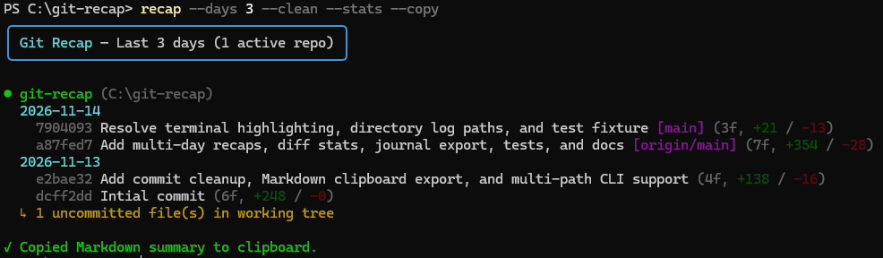

# git-recap

A fast, offline-first CLI tool that scans local Git repositories on your machine and formats a clean summary of your recent commits and work-in-progress files.



## Features

- **Multi-Repo & Multi-Path Scanning:** Scan a single project, a parent workspace folder, or multiple directories across drives while skipping heavy folders like `node_modules` and `.venv`.
- **Flexible Time Windows:** Look back by `--hours`, `--days`, or `--weeks`, automatically grouping multi-day summaries by date.
- **Noise Filtering & Cleanup (`--clean`):** Hides low-value commits (`wip`, `temp`, `.`) and strips conventional prefixes (`feat:`, `fix:`) for readable standup bullets.
- **Branch Labels & Diff Stats (`--stats`):** Displays branch names and line/file change counts (`+42 / -10`) so major changes stand out.
- **Clipboard & Journal Export (`--copy`, `--save`):** Copy formatted Markdown straight to your clipboard or append dated entries to `recap-log.md`.

## Installation

Clone the repository and install it locally using `pip`:

```bash
git clone [https://github.com/](https://github.com/)<your-username>/git-recap.git
cd git-recap
pip install -e .